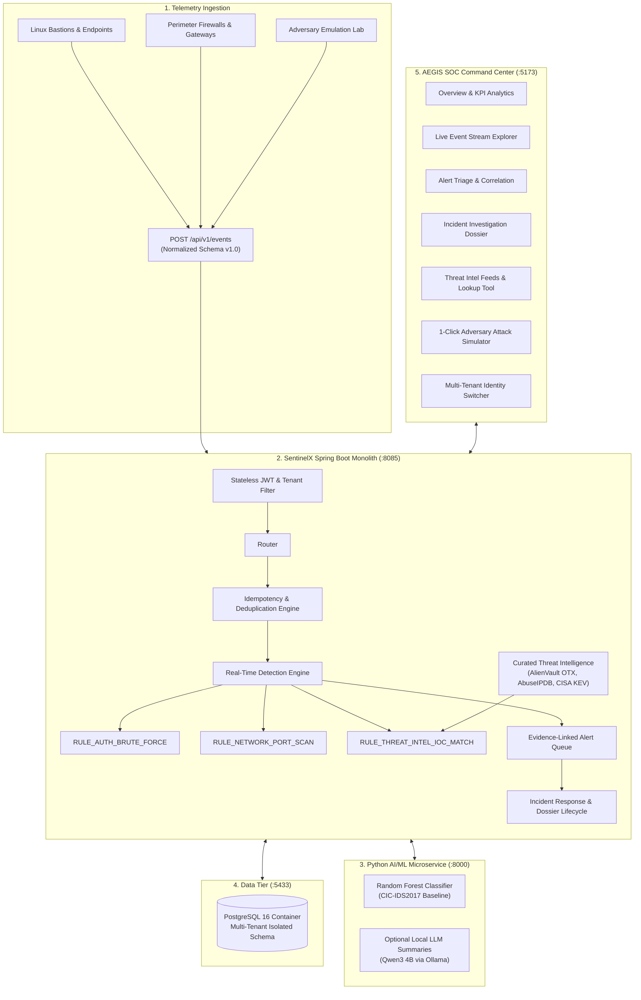

# SentinelX — Local-First AI-Assisted SOC & SIEM Platform


> **SentinelX** is an enterprise-grade, local-first Security Operations Center (SOC) and SIEM platform designed to eliminate the multi-thousand dollar barrier to entry of proprietary cloud SIEMs. Built strictly on a **₹0 development budget**, SentinelX delivers real-time normalized telemetry ingestion, deterministic rule detection, curated threat intelligence correlation, full incident investigation lifecycles, and machine-learning threat scoring on a standard developer workstation.

---

## 🏛️ System Architecture



---

## ✨ Key Capabilities

| Capability | Implementation Details |
| :--- | :--- |
| **🛡️ Multi-Tenant Isolation** | Strict server-side `tenant_id` scoping across all tables and queries. Analysts in Tenant Alpha can never inspect or mutate Tenant Beta's telemetry. Verified with automated cross-tenant security tests. |
| **⚡ High-Throughput Ingestion** | Schema v1.0 standard with payload normalization, size limits, and `idempotency_key` deduplication ensuring network retries never spawn duplicate events. |
| **🎯 Deterministic Detection Rules** | Multi-event sliding-window state machines: <br>• `RULE_AUTH_BRUTE_FORCE`: $\ge 3$ failed logins within 5 minutes.<br>• `RULE_NETWORK_PORT_SCAN`: $\ge 2$ port scan/drop events within 10 minutes. |
| **🌐 Threat Intelligence & IOC Matching** | Real-time correlation against pre-seeded threat indicators (Cobalt Strike C2, LockBit ransomware gateways, Emotet botnets). Includes an instant **Quick Reputation Lookup** tool. |
| **🚨 Incident Response Workspace** | Escalate high-severity alerts into formal incident dossiers with analyst assignment, investigation notes, status progression (`NEW` $\to$ `ASSIGNED` $\to$ `IN_PROGRESS` $\to$ `CONTAINED` $\to$ `CLOSED`), and audit logs. |
| **🤖 AI/ML Network Threat Classifier** | Supervised Random Forest pipeline trained on 12,000 CIC-IDS2017 flow samples with strict leakage shielding (dropped source/destination IPs to prevent overfitting). Served via FastAPI with fallback isolation. |
| **📊 AEGIS Dark-Mode SOC Console** | Modern React 18 + TypeScript + TailwindCSS single-page application with glassmorphic cards, live telemetry tables, and an interactive **Adversary Attack Simulator**. |
| **🔍 Enterprise Observability** | Structured JSON logs, Spring Boot Actuator probes (`/api/v1/health`), and Prometheus metrics endpoint (`/actuator/prometheus`). |

---

## 🚀 Quickstart Guide (Run in 3 Steps)

### Prerequisites
- **Java 21 JDK** (OpenJDK / Eclipse Temurin)
- **Node.js** v20+ or v22+ and `npm`
- **Docker Desktop** (or native PostgreSQL)
- **Python 3.10+** (Optional, for AI/ML service and automated CLI demo)

---

### Step 1: Start the PostgreSQL Database
```bash
docker compose up -d
```
*Spins up PostgreSQL 16 on host port `5433` (configured to prevent conflicts with default port `5432`).*

---

### Step 2: Start the Spring Boot Backend
```bash
cd backend

# On Windows PowerShell:
.\mvnw.cmd spring-boot:run

# On Linux / macOS:
./mvnw spring-boot:run
```
*Backend initializes on port **`8085`** and automatically seeds multi-tenant accounts, detection rules, and threat feeds.*

Verify health at: `http://localhost:8085/api/v1/health`

---

### Step 3: Launch the AEGIS SOC Web Console
```bash
cd frontend
npm install
npm run dev
```
Open **`http://localhost:5173`** in your browser. All API requests automatically proxy to the backend.

---

### Optional: Start the Python AI/ML Microservice
```bash
cd ai-service
py -m venv venv
.\venv\Scripts\activate
pip install -r requirements.txt
py train.py --model rf
py -m uvicorn main:app --port 8000 --reload
```
Interactive API documentation: `http://localhost:8000/docs`

---

## 🎬 Reproducible Portfolio Walkthroughs

You can demonstrate SentinelX live to recruiters or evaluators in two ways:

### Option A: In-Browser 1-Click Attack Simulator (Easiest)
1. Open the SOC console at `http://localhost:5173`.
2. Click the **Attack Simulator** tab.
3. Click **"Simulate Brute Force"** $\to$ watch failed authentications stream in real time and trigger `RULE_AUTH_BRUTE_FORCE`.
4. Click **"Simulate C2 Beacon"** $\to$ watch telemetry beaconing to Cobalt Strike C2 IP (`198.51.100.23`) trigger `RULE_THREAT_INTEL_IOC_MATCH` (`CRITICAL`).
5. Click **"View Generated Alerts"** $\to$ escalate to an **Incident** $\to$ append investigation notes and contain the threat!
6. Click the **Identity Switcher** in the top navbar and switch to **Beta Security Ops** $\to$ notice that Alpha's incidents and alerts disappear completely, demonstrating strict multi-tenancy.

---

### Option B: Automated Terminal Walkthrough Script
Run the automated end-to-end Python demo script (uses only standard library, 0 pip packages required):
```bash
py scripts/portfolio_demo.py
```
**What the script executes:**
1. Authenticates as Analyst Alpha.
2. Ingests multi-vector attack telemetry (SSH brute force + C2 traffic).
3. Verifies detection alerts and threat intelligence hits.
4. Queries AlienVault OTX threat feed reputation via `/threat-intel/lookup`.
5. Escalates the alert into an **Incident** and marks it `CONTAINED`.
6. Authenticates as Analyst Beta and proves HTTP `404/403` isolation against Alpha's incident.

---

## 🔐 Pre-Seeded Development Credentials

| Account Display Name | Email | Password | Role | Tenant |
| :--- | :--- | :--- | :---: | :--- |
| **Alpha Defense Lab (Analyst)** | `analyst@alpha.local` | `DevAnalyst123!` | `ANALYST` | `alpha-lab` (Primary) |
| **Alpha Defense Lab (Admin)** | `admin@alpha.local` | `DevAdmin123!` | `ADMIN` | `alpha-lab` (Primary) |
| **Beta Security Ops (Analyst)** | `analyst@beta.local` | `DevAnalyst123!` | `ANALYST` | `beta-ops` (Isolation Test) |
| **Platform Super Admin** | `platform@sentinelx.local` | `DevAdmin123!` | `ADMIN` | Global Management |

---

## 🧪 Test Verification & Engineering Rigor

SentinelX is developed using strict test-driven acceptance criteria before tickets are marked complete:

```bash
cd backend
.\mvnw.cmd test
```
- **32 Automated Tests** passing with **0 Failures**:
  - `TenantIsolationAndAuthorizationTests` (Cross-tenant security boundaries)
  - `EventIngestionTests` (Idempotency deduplication, schema validation)
  - `DetectionIntegrationTests` (Sliding-window threshold rules)
  - `ThreatIntelIntegrationTests` (Curated feed matching, custom IOC lifecycle)
  - `ObservabilityIntegrationTests` (Actuator endpoints, Prometheus metrics)

```bash
cd frontend
npm run build
```
- **Production Bundle Verified**: TypeScript compile (`tsc -b`) and Vite production bundle succeed with 0 errors.

---

## 📋 Implementation Milestones

- [x] **Phase 0 — Planning & Stack Validation** (`SX-0001` - `SX-0003`)
- [x] **Phase 1 — Foundation & Docker Profiles** (`SX-0101` - `SX-0106`)
- [x] **Phase 2 — Identity, Multi-Tenancy & RBAC** (`SX-0201` - `SX-0205`)
- [x] **Phase 3 — Normalized Ingestion & Idempotency** (`SX-0301` - `SX-0305`)
- [x] **Phase 4 — Rule Detection Engine & Deduplication** (`SX-0401` - `SX-0405`)
- [x] **Phase 5 — AEGIS SOC Web Console** (`SX-0501` - `SX-0505`)
- [x] **Phase 6 — Incident Management & Dossiers** (`SX-0601` - `SX-0604`)
- [x] **Phase 7 — Observability & Prometheus Metrics** (`SX-0701` - `SX-0702`)
- [x] **Phase 8 — AI/ML Model Strategy & Network Scoring** (`SX-0801` - `SX-0807`)
- [x] **Phase 9 — Threat Intelligence & Curated Feeds** (`SX-0901`)
- [x] **Phase 13 — Portfolio Release & Automated Demo** (`SX-1301`)

---

## 📄 License & Attribution

- Built as an open-source, educational SIEM / SOC research platform.
- Datasets used: [CIC-IDS2017](https://www.unb.ca/cic/datasets/ids-2017.html) (Canadian Institute for Cybersecurity) under research license.
- Curated threat indicator taxonomy inspired by AlienVault OTX, AbuseIPDB, and CISA KEV public disclosures.
